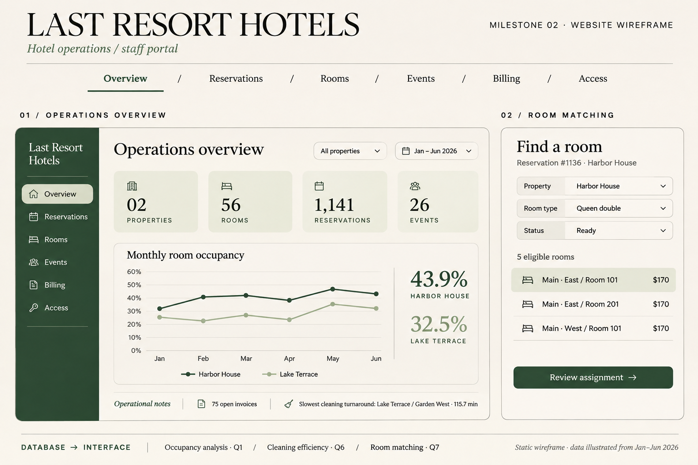
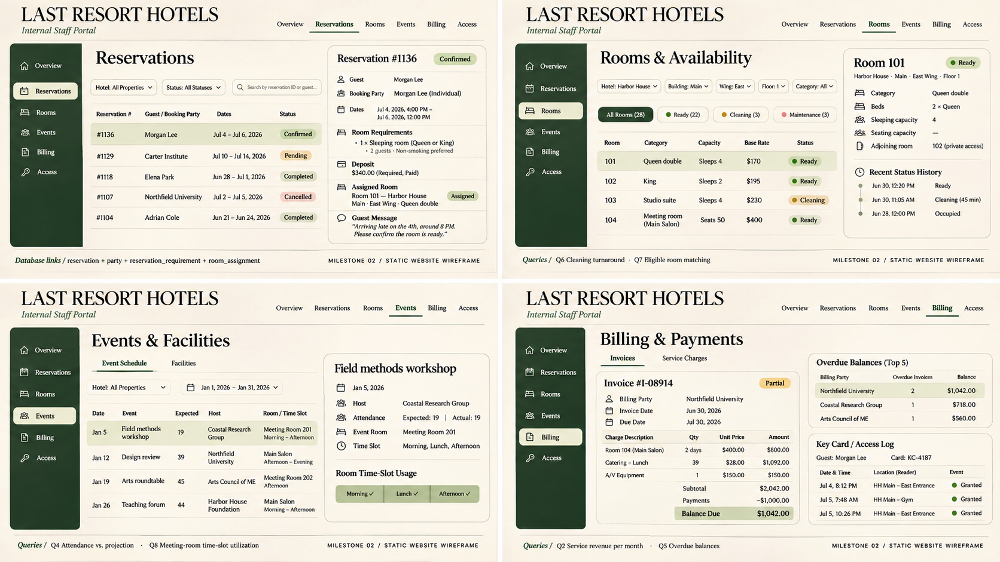

# Last Resort Hotels — Milestone 2

Database Design and Implementation group project. Team: Jeffrey Chen, Charlotte Ma, Dennis Zhu.

## Submission contents

This submission implements a fictional hotel chain's staff-facing operations database and demonstrates eight analytical/operational queries. It includes a populated SQLite database, its reproducible DDL/DML export, query results and interpretation, and static interface mockups.

| Deliverable | File |
| --- | --- |
| Database schema and seed records (CREATE, constraints, triggers, INSERT) | [LastResortHotels_Database.sql](LastResortHotels_Database.sql) |
| Eight reporting queries | [LastResortHotels_Queries.sql](LastResortHotels_Queries.sql) |
| Initial populated database export | [LastResortHotels.db](LastResortHotels.db) |
| Analysis, results, assumptions, and setup | This README |
| Operations overview mockup | [Overview](wireframe_overview.png) |
| Reservations, rooms, events, billing mockups | [Operations](wireframe_operations.png) |
| Current implementation's fields and constraints | [Schema dictionary](schema.md) |
| Original Milestone 1 design, retained for reference | [ERD](milestone1_erd.pdf), [draft analysis](milestone1_draft_analysis.pdf) |
| Reproducibility and integrity checks | [verify.py](verify.py) |

The original Milestone 1 PDFs are archived design documents, not the revised implementation specification. The SQL and schema dictionary are authoritative for Milestone 2. The instructor's project description is not republished here.

## Scenario and organization

Last Resort Hotels needs a shared view of rooms, reservations, guests, events, charges, payments and operational readiness across multiple properties. Staff must distinguish what a customer requests from which room is ultimately assigned, and who uses a service from who pays for it.

The physical hierarchy is `hotel_complex → building → wing → floor → room`. Room numbers may repeat in different wings. `room_bed` and `bed_type` describe bed configurations, while `room_connection` records connections between rooms. `facility` covers additional property services.

`party` represents a person or organization; `person`, `organization`, and `organization_person` separate personal details from organizational affiliations. `reservation`, `reservation_requirement`, and `requirement_bed` capture bookings and requests. `room_assignment` and `assignment_guest` record actual allocations and occupants, including room moves.

`event`, `event_room`, `event_attendee`, and `time_slot` support event scheduling and participation. `service`, `charge`, `invoice`, `invoice_charge`, and `payment` separate service definitions, incurred expenses, billing responsibility, split allocations and settlement. `staff`, `room_status_history`, `key_card`, `card_reader`, `access_log`, and `guest_message` support staff operations and guest communication.

## Running the submission

Use SQLite, not MySQL. The queries use SQLite date functions, recursive CTEs and window functions. SQLite 3.25 or later supports the features used here.

Open the supplied `.db` in DB Browser for SQLite and run the queries in Execute SQL, or run these commands from the downloaded repository folder:

```sh
sqlite3 -header -column LastResortHotels.db < LastResortHotels_Queries.sql
```

To rebuild from the SQL export, choose a **new, empty** output database:

```sh
sqlite3 LastResortHotels_rebuilt.db < LastResortHotels_Database.sql
sqlite3 -header -column LastResortHotels_rebuilt.db < LastResortHotels_Queries.sql
python3 verify.py
```

The seed script deliberately does not drop existing tables. Do not run it over an already populated database. Enable `PRAGMA foreign_keys = ON;` in every application connection that writes data. The included verification script needs only Python's standard library.

## Dataset scope

The synthetic data covers two quarters, January–June 2026, with several forward reservations and spillover activity in July. Reservation intervals run from January 1 through July 11. Reporting uses January 1 inclusive through July 1 exclusive, except Q5's end-of-June balance snapshot and Q7's future booking example. All money is USD. Timestamps use consistent local hotel time for this demonstration.

There are 33 application tables, two properties, 56 rooms (48 sleeping-capable rooms), 1,141 reservations and 26 events. Multiple payments, split invoices, cancellations, bed requests, cleaning histories and access logs provide depth beyond a minimal dataset. Results illustrate the seeded scenario; they are not evidence about real hotels.

<details>
<summary>Record count for every table</summary>

| Table | Records |
| --- | --- |
| hotel_complex | 2 |
| building | 4 |
| wing | 8 |
| floor | 16 |
| room | 56 |
| bed_type | 3 |
| room_bed | 48 |
| room_connection | 16 |
| facility | 8 |
| party | 184 |
| person | 180 |
| organization | 4 |
| organization_person | 20 |
| staff | 8 |
| reservation | 1141 |
| reservation_requirement | 1141 |
| requirement_bed | 1115 |
| room_assignment | 1009 |
| assignment_guest | 1648 |
| time_slot | 7 |
| event | 26 |
| event_room | 69 |
| event_attendee | 902 |
| service | 5 |
| charge | 1868 |
| invoice | 1145 |
| invoice_charge | 1894 |
| payment | 1248 |
| room_status_history | 2082 |
| key_card | 180 |
| card_reader | 64 |
| access_log | 3167 |
| guest_message | 98 |

</details>

## Normalization and revisions

The design targets 3NF under the stated business assumptions: one value per field, no repeating numbered columns, relationship attributes dependent on their whole relationship key, and descriptive facts stored with the entity they describe. Surrogate primary keys alone do not establish normalization; the composite UNIQUE constraints preserve the relevant natural keys.

- Hotel names and addresses are stored with properties, not repeated on rooms or assignments. Location joins recover the hierarchy.
- Bed definitions live in `bed_type`; `room_bed.quantity` depends on the room–bed-type pair. Requested bed quantities depend on the requirement–bed-type pair.
- Person and organization details are separated from bookings and bills. Membership attributes belong to the organization–person pair.
- Service descriptions/default prices are separated from transaction prices. A historical `charge.unitPrice` is an agreed transaction value and need not equal today's service default. Similarly, assignment and event rates are historical agreements, not copies that must track current room prices.
- Charges and payments are aggregated independently before calculating balances, preventing multiplication from a many-to-many join. Invoice allocations describe the invoice–charge pair.
- Room categories are descriptive labels; they do not determine each room's price, capacity or amenities. Names and postal codes are not assumed to uniquely determine other attributes. Event host and dates are event-specific and are not assumed to be determined by the booking party or reservation interval.

Changes made for this submission:

1. Rebuilt the `.db` from the actual schema/seed script, omitting an accidental extra table containing imported SQL source text. The delivered database has exactly 33 application tables.
2. Standardized table names to snake_case and fields to camelCase, including all foreign keys, triggers and queries. Existing IDs and underlying records were preserved.
3. Removed stored `sleepingCapable` and `meetingCapable`: derive them from `sleepingCapacity > 0` and `seatingCapacity > 0`. Removed stored `depositRequired`: derive it from `depositAmount > 0`, consistent with the original constraint. These duplicate facts otherwise create non-key dependencies. Q3 still exposes a calculated `depositRequired` result column.
4. Retained the implemented `canSmoke` field and floor/room smoking checks; the original ERD omitted this field.
5. Made Q1 count each room-night once using EXISTS, so duplicate assignments cannot inflate its inventory denominator. Harmonized the reporting period for Q2, Q4, Q6 and Q8.
6. Added actual results, interpretations, limitations and reproducible verification. Q5 excludes void/cancelled invoices and checks issuance before the snapshot cutoff.

## Queries, results and interpretation

All tables below are outputs of the delivered queries against the delivered database. Query labels match the SQL file.

### Q1. What share of installed sleeping-room inventory was occupied each month?

**Purpose:** Compare occupied room-nights across properties and months to support staffing and demand planning. Uses a recursive calendar, location joins and grouped occupancy counts.

**Definition:** Occupancy is actual overnight presence divided by installed sleeping-room inventory. Checkout day is excluded; an open actual stay is capped at the reporting cutoff. Inventory includes temporarily unavailable rooms, so this is not sellable-room occupancy. The same-day/day-use case is outside this overnight metric.

**Interpretation:** Harbor House exceeds Lake Terrace in every month. Both peak in May (45.3% and 37.1%). June is 43.9% versus 32.5%, suggesting room to investigate weaker demand at Lake Terrace rather than assuming capacity expansion is needed.

| complexName | month | occupied_room_nights | inventory_room_nights | occupancy_pct |
| --- | --- | --- | --- | --- |
| Harbor House | 2026-01 | 232 | 744 | 31.2 |
| Lake Terrace | 2026-01 | 201 | 744 | 27.0 |
| Harbor House | 2026-02 | 274 | 672 | 40.8 |
| Lake Terrace | 2026-02 | 166 | 672 | 24.7 |
| Harbor House | 2026-03 | 311 | 744 | 41.8 |
| Lake Terrace | 2026-03 | 209 | 744 | 28.1 |
| Harbor House | 2026-04 | 279 | 720 | 38.8 |
| Lake Terrace | 2026-04 | 177 | 720 | 24.6 |
| Harbor House | 2026-05 | 337 | 744 | 45.3 |
| Lake Terrace | 2026-05 | 276 | 744 | 37.1 |
| Harbor House | 2026-06 | 316 | 720 | 43.9 |
| Lake Terrace | 2026-06 | 234 | 720 | 32.5 |

### Q2. Which services generated posted charges each month, and how much?

**Purpose:** Compare monthly billed activity by service category using charge–service joins and grouped sums.

**Interpretation:** Lodging dominates and reaches $115,190 in May; dining reaches $7,606 that month. These are **posted charges**, not cash collections or profit. July's $14,985 lodging charges are intentionally outside this six-month report; they remain in the database. Category differences should be interpreted alongside the number and mix of services offered.

| month | serviceCategory | charge_count | posted_usd |
| --- | --- | --- | --- |
| 2026-01 | Lodging | 140 | 75205.0 |
| 2026-01 | Dining | 74 | 6310.0 |
| 2026-01 | Events | 8 | 1900.0 |
| 2026-01 | Recreation | 43 | 774.0 |
| 2026-01 | Business | 2 | 130.0 |
| 2026-02 | Lodging | 145 | 84870.0 |
| 2026-02 | Dining | 82 | 6735.0 |
| 2026-02 | Events | 8 | 2100.0 |
| 2026-02 | Recreation | 38 | 684.0 |
| 2026-02 | Business | 3 | 195.0 |
| 2026-03 | Lodging | 164 | 97230.0 |
| 2026-03 | Dining | 87 | 6937.0 |
| 2026-03 | Events | 10 | 2475.0 |
| 2026-03 | Recreation | 42 | 756.0 |
| 2026-03 | Business | 3 | 195.0 |
| 2026-04 | Lodging | 153 | 89150.0 |
| 2026-04 | Dining | 79 | 5611.0 |
| 2026-04 | Events | 8 | 2100.0 |
| 2026-04 | Recreation | 41 | 738.0 |
| 2026-04 | Business | 3 | 195.0 |
| 2026-05 | Lodging | 204 | 115190.0 |
| 2026-05 | Dining | 112 | 7606.0 |
| 2026-05 | Events | 8 | 2100.0 |
| 2026-05 | Recreation | 52 | 936.0 |
| 2026-05 | Business | 3 | 195.0 |
| 2026-06 | Lodging | 178 | 97640.0 |
| 2026-06 | Dining | 93 | 7461.0 |
| 2026-06 | Events | 10 | 2475.0 |
| 2026-06 | Recreation | 47 | 846.0 |
| 2026-06 | Business | 3 | 195.0 |

### Q3. How did cancellation rates differ for overnight bookings with and without a required deposit?

**Purpose:** Compare cancellation rates for overnight bookings with and without positive required deposits. EXISTS selects sleeping bookings without duplicating reservations across requirements.

**Interpretation:** Bookings with deposits have an 8.5% cancellation rate versus 9.3% without, a difference of 0.8 percentage points. This is an association in synthetic data, not proof that deposits reduce cancellations. Customer selection and booking characteristics may differ.

| depositRequired | bookings | cancellations | cancellation_pct |
| --- | --- | --- | --- |
| 0 | 719 | 67 | 9.3 |
| 1 | 390 | 33 | 8.5 |

### Q4. Which hosts consistently overestimated or underestimated event attendance?

**Purpose:** Compare recorded event participants with host estimates to support catering and staffing forecasts. The per-event count is aggregated again by host.

**Interpretation:** Coastal Field Institute's 230 recorded participants are below its total estimate of 247, averaging 2.4 fewer per event. Northline Design is accurate in total, but individual over- and underestimates cancel out. `event_attendee` is treated as recorded participation for this exercise; there is no check-in flag proving physical attendance.

| host | events | expected | recorded | above_estimate | below_estimate | mean_error_people |
| --- | --- | --- | --- | --- | --- | --- |
| Finger Lakes Arts Council | 6 | 217 | 222 | 3 | 1 | 0.8 |
| Northline Design | 7 | 252 | 252 | 4 | 3 | 0.0 |
| Harbor Education Group | 6 | 205 | 198 | 2 | 4 | -1.2 |
| Coastal Field Institute | 7 | 247 | 230 | 0 | 6 | -2.4 |

### Q5. Which billing parties had the most overdue money at the close of June 30?

**Purpose:** Prioritize collection follow-up by aggregating invoice allocations and payments separately, computing positive overdue balances, and ranking billing parties.

**Interpretation:** Hugo Brooks has the largest overdue total, $2,553 across six invoices, followed by Omar Ito at $2,381. These are the top ten parties, not the whole receivables ledger. Only payments before July 1 reduce this snapshot. Invoice allocations are assumed immutable after issue; without allocation/status history, the database cannot reconstruct every historical edit.

| billing_party | overdue_invoices | overdue_usd |
| --- | --- | --- |
| Hugo Brooks | 6 | 2553.0 |
| Omar Ito | 6 | 2381.0 |
| Grace Flores | 3 | 2071.5 |
| Harbor Education Group | 3 | 1927.5 |
| Farah Ito | 5 | 1771.5 |
| Hugo Flores | 3 | 1744.0 |
| Eli Lane | 3 | 1693.5 |
| Farah Lane | 4 | 1620.5 |
| Maya Chen | 2 | 1585.0 |
| Remi Flores | 2 | 1391.0 |

### Q6. Which wings take longest to return rooms to service after departure cleaning?

**Purpose:** Identify slower housekeeping turnaround using LEAD over each room's status history, then average completed cleaning-to-ready transitions by wing.

**Interpretation:** Lake Terrace / Garden / West is slowest at 114.3 minutes across 22 completed transitions in H1. Small sample sizes and room complexity matter before changing staffing. Cleaning episodes interrupted by another status, or not ready before July 1, are excluded. This measures recorded cleaning-to-ready time, not total checkout-to-ready downtime.

| complexName | buildingName | wingCode | completed_cleans | avg_minutes |
| --- | --- | --- | --- | --- |
| Lake Terrace | Garden | West | 22 | 114.3 |
| Harbor House | Garden | West | 37 | 98.8 |
| Harbor House | Main | East | 263 | 94.8 |
| Lake Terrace | Main | West | 106 | 93.5 |
| Lake Terrace | Garden | East | 67 | 92.6 |
| Harbor House | Main | West | 161 | 92.4 |
| Harbor House | Garden | East | 104 | 90.9 |
| Lake Terrace | Main | East | 224 | 89.4 |

### Q7. Which eligible rooms should the desk offer for the earliest unassigned Harbor House request?

**Purpose:** Find eligible rooms for the earliest unassigned, single-room Harbor House request. Joins and nested NOT EXISTS checks combine capacity, bed types, accessibility, smoking, scheduled conflicts, event slots and recorded readiness. Candidates are ordered by wing priority and room number.

**Interpretation:** Reservation 1136 has five displayed candidates, starting with Main / East / 101, each at $170 base daily rate. This is a recommendation query, not an assignment transaction. It assumes property ID 1 is Harbor House and the exact preference note identifies that request. Text preferences should become structured selections in a production interface. Future readiness is only as reliable as recorded status history and must be rechecked at arrival. LIMIT 5 is a display limit, not proof there are exactly five eligible rooms.

| reservationId | buildingName | wingCode | wingSequence | roomNumber | roomCategory | baseDailyRate |
| --- | --- | --- | --- | --- | --- | --- |
| 1136 | Main | East | 1 | 101 | Queen double | 170 |
| 1136 | Main | East | 1 | 201 | Queen double | 170 |
| 1136 | Main | West | 2 | 101 | Queen double | 170 |
| 1136 | Main | West | 2 | 201 | Queen double | 170 |
| 1136 | Garden | East | 3 | 101 | Queen double | 170 |

### Q8. Which meeting periods are used most, and how often are they complimentary?

**Purpose:** Compare booked event-room periods, distinct events, complimentary slots and agreed room fees. A LEFT JOIN retains unused slot categories.

**Interpretation:** Morning and Afternoon each have 26 booked slots; 17 Morning slots are complimentary. Lunch has 17 bookings and $6,800 agreed fees. Breakfast, Supper, Evening and Night have no bookings. These are usage counts, not utilization percentages: the query does not divide by the total capacity of available room/date/slot combinations. Agreed fees are not necessarily collected cash.

| slotName | booked_slots | events_served | free_slots | agreed_room_fees_usd |
| --- | --- | --- | --- | --- |
| Morning | 26 | 26 | 17 | 1800 |
| Afternoon | 26 | 26 | 0 | 4550 |
| Lunch | 17 | 17 | 0 | 6800 |
| Breakfast | 0 | 0 | 0 | 0 |
| Supper | 0 | 0 | 0 | 0 |
| Evening | 0 | 0 | 0 | 0 |
| Night | 0 | 0 | 0 | 0 |

## Interface mockups and database connections

These are static design mockups, not a deployed application. Mockup names, amounts and some graph values are illustrative and may differ from the seeded records. The verified query outputs above are authoritative; specifically the H1 cleaning result is 114.3 minutes rather than the mockup's 115.7.

| Screen | Intended interaction | Supporting tables / queries |
| --- | --- | --- |
| Overview | Choose property and date range; compare occupancy and cleaning | Q1, Q6; property hierarchy, assignments, status history |
| Reservations | Filter bookings and inspect requested versus assigned rooms | reservation, party, reservation_requirement, room_assignment |
| Rooms | Inspect capacity, beds, readiness; review eligible assignments | room, room_bed, room_status_history; Q7 |
| Events | Compare attendance estimates and schedule room slots | event, event_attendee, event_room, time_slot; Q4, Q8 |
| Billing | Inspect service charges, payments and overdue balances | charge, invoice, invoice_charge, payment; Q2, Q5 |
| Access | Inspect recent card activity subject to staff permissions | key_card, card_reader, access_log; separate screen planned |





## Validation and remaining assumptions

The shipped database and an independent rebuild were checked for SQLite integrity, foreign-key violations, table/record agreement and successful execution of all eight queries. Scheduled noncancelled room assignments have no pairwise overlaps in the seed data. This is a dataset check, not a claim that all future conflicting writes are prevented by the database.

The database enforces primary/foreign keys, natural-key uniqueness, selected range/time checks, one primary guest per assignment, one event booking per room/date/slot, and floor/room smoking and room-number consistency. Some cross-table policies need additional transactional application logic: preventing overlaps between lodging and events, maintaining subtype membership, ensuring allocations exactly cover posted charges, one billing party for each meeting-room charge, capacity checks on every assignment, and race-free room selection.

Movable-wall layouts, full pricing/discount automation, customer deposit qualification scoring and complete guest-location tracking remain outside this milestone's implemented scope, as anticipated in the draft analysis. Card swipes indicate observed activity, not guaranteed current location. Sample PIN hashes are demonstration data, not a production authentication implementation. A production system also needs authentication, staff permissions, confidentiality enforcement and appropriate monetary storage/rounding.

## Three-member coordination and handoff

The team has three members: Jeffrey Chen, Charlotte Ma and Dennis Zhu. The shared review plan is to divide database/data maintenance, query/interpretation checks, and interface/documentation work into comparable tasks, with a second member reviewing each area. Each member should rebuild the database and explain at least one query before submission. Track changes in commits/issues, raise blockers early and redistribute unfinished work at checkpoints. This is a coordination plan, not an assertion that particular members completed unverified work.

The repository is intended to be accessible to the grader. Team members should be added as collaborators using their actual GitHub usernames; names alone are insufficient to send invitations. Submit the repository URL through the course's required submission channel.
